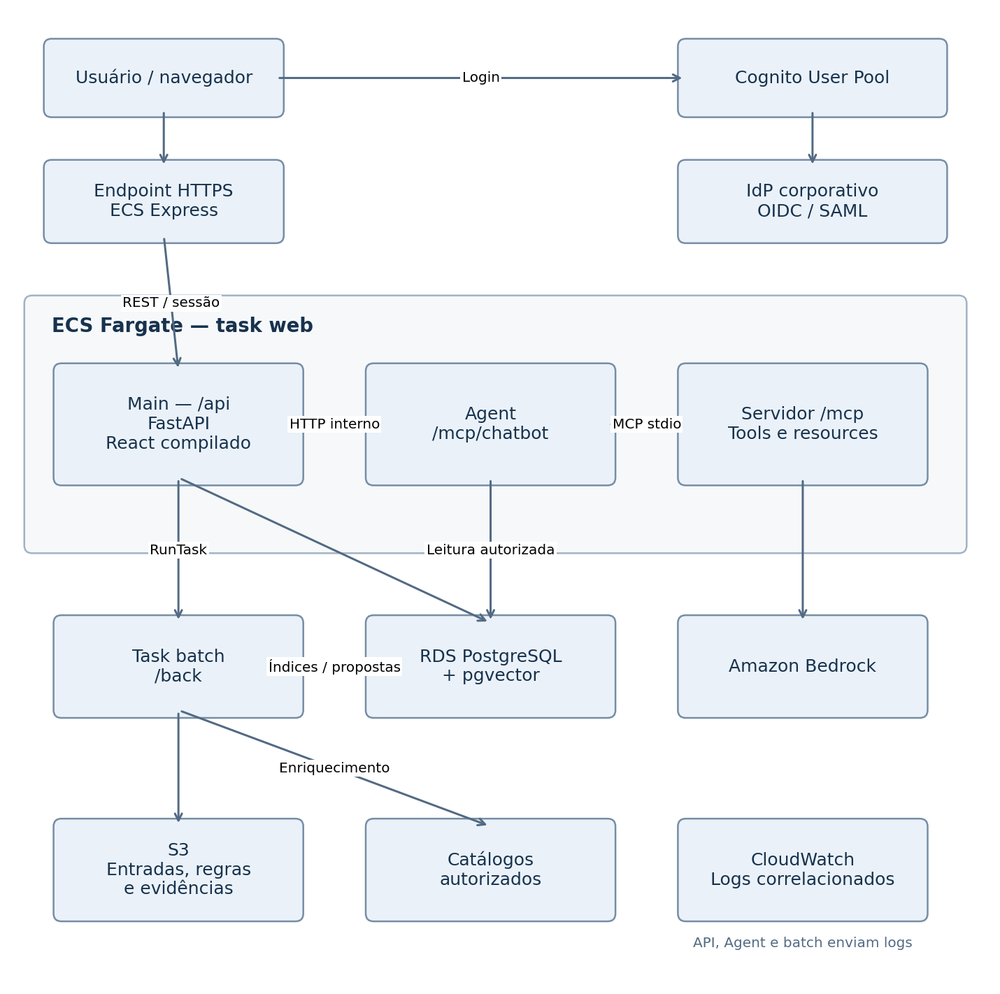

# Arquitetura do produto

> **Onde o repositório já difere deste documento**
>
> - **Front:** usa Next.js com export estático, não uma SPA React. A estrutura real está em [`front/README.md`](../front/README.md). A API continua servindo o build na mesma origem; a pasta é `front/out`.
> - **Propriedade do código (seção 7):** qualquer pessoa pode trabalhar em qualquer área. Ver [`AGENTS.md`](../AGENTS.md).
> - **Dados:** enquanto não há banco, o kit fica em [`data/`](../data/README.md).
> - **Pacotes Python (seção 4):** `mcp` e `api` ficam em `mcp/vx_materials_mcp/` e `api/vx_materials_api/`, em um único workspace uv com `uv.lock` na raiz.
> - **Normalização (seção 4):** fica em `back/repositories/normalization/`, não em `domain/normalization.py`, para permitir a troca de algoritmos.
> - **Aprovação automática:** a decisão está em aberto na [issue #36](https://github.com/fernandobruzzi/Hackathon-VX-Grupo-3/issues/36).

## 1. Diagrama e fluxo de arquitetura na AWS

### Serviços e implantação escolhidos

| Componente | Decisão |
|---|---|
| Execução web | ECS Fargate com Express Mode, inicialmente uma task |
| Container principal | Main, executando FastAPI e servindo o build estático do React |
| Container de atendimento | Agent, executando /mcp/chatbot e seu servidor MCP local |
| Batch | Task Fargate independente, iniciada com ECS RunTask |
| Banco operacional | RDS PostgreSQL, privado, com extensão vector |
| Busca híbrida | PostgreSQL full-text + comparação de atributos/códigos + pgvector |
| Arquivos e evidências | S3 privado, com versionamento |
| Autenticação | Cognito User Pool, Authorization Code + PKCE |
| Modelos | Bedrock, com modelo conversacional configurável e Titan Text Embeddings V2 |
| Segredos | Secrets Manager |
| Logs | CloudWatch, correlacionados por request_id, job_id e session_id |
| Imagens | ECR |

O Express Mode fornece endereço HTTPS e provisiona os componentes de entrada do serviço. Ele aceita task definitions com sidecars, o que permite executar Main e Agent juntos. Isso evita depender de um domínio próprio para começar a demonstração. [Amazon Elastic Container Service](https://docs.aws.amazon.com/AmazonECS/latest/developerguide/express-service-overview.html)

Os quatro módulos do repositório não precisam corresponder a quatro serviços permanentes. O frontend será compilado separadamente, mas servido pela API. Essa escolha mantém login, cookies e chamadas REST na mesma origem HTTPS.

### Diagrama completo



### Rede e limites de segurança

Para a configuração mais simples de demonstração pública:

- Serviço Express em subnets públicas, com ingresso da aplicação permitido apenas pelo security group do balanceador.
- RDS em subnets privadas, sem acesso público.
- Porta PostgreSQL liberada somente para os security groups da aplicação e do batch.
- Agent acessível apenas internamente, sem publicação da porta de atendimento.
- Tasks batch com saída para internet, sem ingresso público.
- S3 com bloqueio de acesso público e permissões por prefixo.

O Express diferencia serviços públicos e privados conforme as subnets fornecidas. Usar subnets privadas nesse fluxo pode resultar em um balanceador interno. A configuração pública acima permite saída para Cognito, Bedrock e catálogos sem acrescentar NAT Gateway ao MVP. [Amazon Elastic Container Service](https://docs.aws.amazon.com/AmazonECS/latest/developerguide/express-service-work.html)

API e Agent, na mesma task, compartilham a task role IAM. A separação entre eles será lógica, reforçada por credenciais SQL diferentes. Isolamento IAM entre esses containers exigiria tasks separadas.

### Fluxo 1: saneamento batch

#### Entrada identificada e reproduzível

O bucket terá estes prefixos lógicos:

| Prefixo | Conteúdo |
|---|---|
| `raw/{dataset_id}/` | Os arquivos originais do kit |
| `references/pdm/{version}/` | Excel original e representação validada das regras |
| `references/ncm/{version}/` | Snapshot oficial e metadados de consulta |
| `evidence/{source_id}/` | Documento ou trecho utilizado no enriquecimento |
| `runs/{job_id}/` | Manifesto, checkpoints, resultados e métricas |
| `exports/{snapshot_id}/` | Resultados aprovados para exportação |

O manifesto registra hashes, versões S3, quantidade de linhas e a lista dos 15 códigos reais. Essa lista permanece vinculada ao arquivo original, mesmo após ordenação ou transformação.

#### Etapas do processamento

- **Ingestão e preservação.** Ler 01, 02 e 03, preservar os originais e validar a estrutura. A carga inicial da base mestre será executada por um comando de bootstrap do /api, usando as credenciais de escrita apropriadas.
- **Compilação do PDM.** Converter as 44 classes e 229 definições de atributos em regras tipadas, incluindo as 14 obrigatoriedades condicionais.
- **Extração.** Usar descrição longa, campos estruturados e conteúdo textual dos anexos. Acionar o LLM para casos que o parser não resolve.
- **Normalização técnica.** Resolver aliases documentados, medidas, grafias de fabricantes e referências. Preservar valor original e regra aplicada.
- **Indexação.** Produzir texto de busca, atributos normalizados e embeddings, registrando modelo e versão.
- **Geração de candidatos.** Recuperar possíveis duplicidades por identidade exata, busca lexical e similaridade vetorial.
- **Verificação de identidade.** Comparar os obrigatórios aplicáveis ou fabricante + referência, conforme a classe.
- **Validação fiscal.** Verificar formato, presença na tabela oficial e coerência com as regras do PDM.
- **Enriquecimento.** Consultar fontes dos 15 produtos reais e registrar evidência por atributo.
- **Propostas.** Persistir sugestões, conflitos, versões observadas e métricas. A aplicação das mudanças ocorre pelo fluxo de aprovação da API.

#### Busca e deduplicação

A busca híbrida usará:

- Correspondência exata de código, fabricante e referência.
- PostgreSQL full-text para termos técnicos.
- pgvector para recuperação semântica.
- Reordenação por compatibilidade dos atributos.

Full-text padrão do PostgreSQL não é BM25. Não precisamos acrescentar outro motor de busca para os 23.554 registros.

Para embeddings, fixaria inicialmente Titan Text Embeddings V2 com **512 dimensões**, configurando a coluna como `vector(512)`. Modelo, dimensão e versão da normalização devem ser iguais na indexação e na consulta. A AWS documenta opções de dimensão para esse modelo. [Amazon Bedrock](https://docs.aws.amazon.com/bedrock/latest/userguide/titan-embedding-models.html)

DN 50, 2" e 2POL podem convergir no atributo de diâmetro nominal. Isso não elimina a comparação de classe de pressão, material, conexão e demais atributos obrigatórios.

#### Tratamento dos estados legados

- ATIVO pode ser candidato a reutilização.
- BLOQUEADO pode aparecer na pesquisa, acompanhado do destino válido.
- OBSOLETO permanece consultável, mas não é reutilizado automaticamente.
- Redirecionamentos legados inconsistentes entram como pendência.
- Unidade de embalagem sem fator conhecido impede consolidação quantitativa automática.

### Fluxo 2: atendimento conversacional

- O usuário autenticado envia uma mensagem pelo /front.
- O /api valida sessão, identidade, permissão e propriedade da conversa.
- A mensagem é persistida e recebe uma versão de processamento.
- A API chama o endpoint interno do /mcp/chatbot.
- O agente consulta o template PDM, extrai atributos e usa as tools.
- Quando falta informação, pergunta pelos campos relevantes.
- Quando encontra um item existente, apresenta código ativo, justificativa e estoque autorizado.
- Quando o item está completo e sem duplicidade confirmada, apresenta um pedido pronto para submissão.
- O solicitante confirma a submissão por uma ação explícita da interface.
- Governança e fiscal realizam as aprovações necessárias.

Validar um pedido no chat não publica um novo material. A publicação é uma operação transacional do /api, com aprovação e nova verificação de duplicidade.

## 2. Arquitetura de autenticação SSO e matriz de permissões

### Cognito e sessão da aplicação

O frontend utilizará o login gerenciado do Cognito. A aplicação adotará um modelo BFF, no qual os tokens ficam no backend e o navegador recebe um identificador opaco de sessão.

O fluxo será:

- `GET /api/v1/auth/sso-start` cria uma transação de login com state, nonce e PKCE.
- O navegador é redirecionado ao Cognito.
- Cognito autentica o usuário diretamente ou por um IdP OIDC/SAML configurado.
- O navegador retorna a `/auth/callback` com code e state.
- A página de callback envia esses valores a `POST /api/v1/auth/sso-callback`.
- A API valida a transação e troca o código usando o code_verifier armazenado.
- A API valida os tokens e cria a sessão.
- O navegador recebe um cookie Secure, HttpOnly, SameSite=Lax.

Authorization Code com PKCE é suportado pelo Cognito. A validação dos JWTs deve incluir assinatura, emissor, validade e os campos específicos do tipo de token. [Amazon Cognito](https://docs.aws.amazon.com/cognito/latest/developerguide/amazon-cognito-user-pools-using-tokens-verifying-a-jwt.html)

#### Validação do access token

- Algoritmo permitido e assinatura conferida com JWKS.
- `iss` igual ao User Pool configurado.
- `exp` válido.
- `token_use = access`.
- `client_id` igual ao app client autorizado.
- Escopos exigidos pela operação.
- `aud`, quando houver audience de recurso configurada.
- Grupos Cognito mapeados para permissões da aplicação.

O ID token será usado para o perfil no login. As decisões de autorização usam a identidade e os grupos validados.

Os grupos Cognito serão exatamente:

- `ROLE_SOLICITANTE`
- `ROLE_GOVERNANCA_PDM`
- `ROLE_AUDITOR_FISCAL`

Os nomes de apresentação do frontend serão mapeados assim:

| Nome da interface | Grupo efetivo |
|---|---|
| SOLICITANTE_OPERACAO | ROLE_SOLICITANTE |
| GESTOR_CADASTRO | ROLE_GOVERNANCA_PDM |
| AUDITOR_FISCAL | ROLE_AUDITOR_FISCAL |

Para demonstrar **SSO corporativo**, é necessário conectar um IdP real ao Cognito. Usuários locais precriados permitem demonstrar login OIDC e RBAC imediatamente, enquanto a federação depende dos metadados e credenciais do provedor da organização.

### Fast-Switch Demo Persona

O seletor rápido alternará entre **três sessões previamente autenticadas**, cada uma pertencente a uma conta real do Cognito.

Antes do pitch:

- Autenticar as três contas.
- Associar as três sessões ao mesmo contexto de navegador de demonstração.
- Confirmar que os access tokens cobrem o período do pitch.
- Preparar o estado inicial de cada tela.

O seletor chama:

```
POST /api/v1/auth/demo/switch
```

```json
{
  "session_handle": "demo_session_fiscal_01"
}
```

O backend verifica:

- DEMO_MODE habilitado.
- Sessão pertencente ao contexto autenticado daquele navegador.
- Conta dentro da lista de usuários de demonstração.
- Sessão não expirada ou revogada.
- Token válido e proteção CSRF.

Em seguida, troca o cookie da sessão ativa. O frontend descarta caches privados e busca novamente `/auth/me`.

Escolher uma persona não concede um papel. A troca exige uma sessão já autenticada daquela conta. Cada alteração continuará registrada com o usuário real correspondente.

### Matriz RBAC

| Ação | Solicitante | Governança PDM | Auditor fiscal |
|---|---|---|---|
| Usar chatbot | Sim | Sim | Sim |
| Consultar materiais e estoque por centro autorizado | Sim | Sim | Sim |
| Abrir e editar pedido próprio | Sim | Sim | Sim |
| Consultar conversa de outro usuário | Não | Apenas vinculada à revisão autorizada | Apenas vinculada à revisão fiscal autorizada |
| Consultar fila técnica | Não | Sim | Leitura relacionada à auditoria |
| Aprovar/rejeitar unificação | Não | Sim | Não |
| Aprovar enriquecimento técnico | Não | Sim | Não |
| Aprovar alteração de NCM | Não | Não | Sim |
| Publicar novo cadastro | Não | Sim, após requisitos fiscais | Não |
| Iniciar/reprocessar batch | Não | Sim | Não |
| Consultar métricas de qualidade | Não | Sim | Sim |
| Consultar métricas financeiras | Não | Não | Sim |
| Consultar auditoria | Próprias ações | Escopo técnico | Escopo fiscal e financeiro |
| Alterar papéis de usuários | Não | Não | Não |

A administração dos grupos fica no Cognito, fora da aplicação do MVP.

Os guards verificarão **ação e recurso**. Possuir `chat:use` não dá acesso a qualquer session_id. Possuir acesso à fila não permite aprovar uma proposta de outra natureza.

### Rastreabilidade

Toda alteração registra:

- Identificador interno do usuário.
- `sub` e emissor do Cognito.
- Papéis presentes na sessão.
- Papel efetivo usado na operação.
- Ação e recurso.
- Valores antes e depois.
- Justificativa.
- Horário do servidor.
- request_id, proposta e job relacionados.

O backend determina esses campos. Tokens, senhas e segredos não entram nos logs.

## 3. Especificação do /mcp e do /mcp/chatbot

### Execução do protocolo

O container Agent terá:

- Um pequeno servidor HTTP interno para receber chamadas do /api.
- O orquestrador em /mcp/chatbot.
- Um servidor MCP iniciado localmente por `mcp_client.py`, usando **stdio**.

O cliente e o servidor se comunicarão pelo protocolo MCP real. stdio é adequado à comunicação local entre cliente e subprocesso e evita expor um segundo endpoint público autenticado. Cliente, servidor e SDK terão versões compatíveis fixadas no lockfile. [Model Context Protocol](https://modelcontextprotocol.io/specification/2026-07-28/basic/transports)

A identidade recebida da API será vinculada à execução. Os parâmetros disponibilizados ao LLM não conterão campos editáveis de usuário, papel ou tenant.

### Regras compartilhadas

O /back/domain será um pacote Python reutilizável com:

- Identidade de materiais.
- Normalização de medidas e aliases.
- Validação do PDM.
- Formatação da descrição.
- Regras de NCM.

O /mcp importará esse pacote. Assim, batch e chat usam a mesma regra para concluir se CLASSE RESISTENCIA está ausente ou se dois filtros possuem a mesma identidade.

O LLM decide quais consultas executar e como formular as perguntas. O motor de domínio valida os dados.

### As cinco tools essenciais

| Tool | Entrada | Retorno |
|---|---|---|
| search_similar_materials | query, pdm_class_id, attributes, limit | Candidatos, código ativo resolvido, diferenças, conflitos, estoque permitido e situação da identidade |
| get_pdm_template | pdm_class_id, pdm_version | Substantivo, qualificador, identidade, atributos, condições, unidade e referência fiscal |
| validate_and_format_pdm | pdm_class_id, pdm_version, attributes | VALID, INCOMPLETE, INVALID ou OUT_OF_SCOPE, campos ausentes, erros e descrição quando válida |
| check_ncm_consistency | pdm_class_id, attributes, ncm, ncm_version | Formato, existência, vigência, coerência, códigos candidatos e necessidade de revisão |
| enrich_from_trusted_source | material_code, attributes_requested, refresh | Valores propostos, fonte por atributo, confiança e divergências |

#### search_similar_materials

Entrada:

```json
{
  "query": "filtro Fleetguard LF 9009",
  "pdm_class_id": "PDM100",
  "attributes": {
    "FABRICANTE": "FLEETGUARD",
    "REFERENCIA FABRICANTE": "LF9009"
  },
  "limit": 5
}
```

Retorno:

```json
{
  "match_status": "REVIEW_REQUIRED",
  "candidates": [
    {
      "material_code": "16031971",
      "status": "ATIVO",
      "active_code_target": null,
      "match_type": "EXACT_MANUFACTURER_REFERENCE",
      "identity_verified": false,
      "ranking_score": 0.97,
      "matching_attributes": ["FABRICANTE", "REFERENCIA FABRICANTE"],
      "conflicts": [],
      "pending_checks": ["CONFIRM_IDENTITY_FROM_SOURCE"],
      "inventory": [
        { "center_code": "1200", "quantity": "4", "unit": "PC" }
      ]
    }
  ]
}
```

`ranking_score` ordena resultados. Ele não representa probabilidade calibrada de equivalência nem autoriza uma unificação.

#### get_pdm_template

Entrada:

```json
{
  "pdm_class_id": "PDM020",
  "pdm_version": "pdm-kit-v1"
}
```

Retorno:

```json
{
  "pdm_class_id": "PDM020",
  "pdm_version": "pdm-kit-v1",
  "noun": "ROLAMENTO",
  "qualifier": "RIGIDO ESFERAS",
  "identity_mode": "TECHNICAL_ATTRIBUTES",
  "default_unit": "PC",
  "attributes": [
    { "name": "REFERENCIA", "order": 1, "required": true, "applies_when": { "operator": "ALWAYS" }, "format": "BEARING_REFERENCE", "allowed_values": null },
    { "name": "DIAMETRO INTERNO", "order": 2, "required": false, "applies_when": { "operator": "ALWAYS" }, "format": "DECIMAL_MM", "allowed_values": null },
    { "name": "DIAMETRO EXTERNO", "order": 3, "required": false, "applies_when": { "operator": "ALWAYS" }, "format": "DECIMAL_MM", "allowed_values": null },
    { "name": "LARGURA", "order": 4, "required": false, "applies_when": { "operator": "ALWAYS" }, "format": "DECIMAL_MM", "allowed_values": null },
    { "name": "VEDACAO", "order": 5, "required": true, "applies_when": { "operator": "ALWAYS" }, "format": "ENUM", "allowed_values": ["ABERTO", "BORRACHA AMBOS LADOS", "METALICA AMBOS LADOS"] },
    { "name": "FOLGA", "order": 6, "required": true, "applies_when": { "operator": "ALWAYS" }, "format": "ENUM", "allowed_values": ["C3", "NORMAL"] }
  ]
}
```

As condições do Excel serão convertidas para operadores controlados, como ALWAYS, EQUALS, IN e NOT_IN. O sistema não executará expressões livres vindas do arquivo.

#### validate_and_format_pdm

Entrada:

```json
{
  "pdm_class_id": "PDM001",
  "pdm_version": "pdm-kit-v1",
  "attributes": {
    "ROSCA": "METRICA GROSSA",
    "BITOLA": "M12",
    "COMPRIMENTO": "50MM",
    "MATERIAL": "ACO CARBONO",
    "ACABAMENTO": "ZINCADO BRANCO",
    "NORMA": "DIN 933"
  }
}
```

Retorno:

```json
{
  "status": "INCOMPLETE",
  "missing_attributes": [
    {
      "name": "CLASSE RESISTENCIA",
      "reason_code": "REQUIRED_ATTRIBUTE_MISSING",
      "question": "Qual é a classe de resistência do parafuso?"
    }
  ],
  "invalid_attributes": [],
  "not_applicable_attributes": [],
  "formatted_description": null,
  "identity_key": null,
  "can_submit": false
}
```

#### check_ncm_consistency

Entrada:

```json
{
  "pdm_class_id": "PDM003",
  "attributes": {
    "TIPO": "SEXTAVADA",
    "BITOLA": "M16"
  },
  "ncm": "7318.15.00",
  "ncm_version": "ncm-demo-v1"
}
```

Retorno:

```json
{
  "input_ncm": "7318.15.00",
  "normalized_ncm": "7318.15.00",
  "syntax_valid": true,
  "exists_in_snapshot": true,
  "valid_in_snapshot": true,
  "technical_consistency": "INCONSISTENT",
  "suggested_ncm_codes": ["7318.16.00"],
  "missing_attributes": [],
  "rule_id": "PDM003_NCM",
  "requires_fiscal_review": true,
  "fiscal_approval_status": "PENDING"
}
```

Esse exemplo pressupõe o snapshot oficial carregado e validado. A vigência será sempre avaliada na data registrada para o snapshot.

#### enrich_from_trusted_source

Entrada:

```json
{
  "material_code": "18308575",
  "attributes_requested": ["FABRICANTE"],
  "refresh": false
}
```

Retorno:

```json
{
  "material_code": "18308575",
  "status": "EVIDENCE_FOUND",
  "attributes": [
    {
      "attribute": "FABRICANTE",
      "valor": "DONALDSON",
      "fonte": {
        "source_id": "src_dbl7300_manufacturer",
        "url": "https://shop.donaldson.com/store/en-br/product/DBL7300/11889",
        "title": "Donaldson DBL7300",
        "excerpt": "Donaldson DBL7300",
        "page": null
      },
      "confianca": {
        "level": "HIGH",
        "basis": ["MANUFACTURER_DOMAIN", "EXACT_PART_NUMBER"]
      },
      "approval_status": "PENDING"
    }
  ],
  "conflicts": []
}
```

A confiança será uma classificação baseada em evidências. Um valor numérico informado pelo LLM não será usado como autorização.

O servidor determina se o código pertence à lista dos 15. As URLs são selecionadas pelo serviço de fontes confiáveis, com limites de domínio, redirecionamentos, tamanho e tempo. A consulta oficial de NCM continua disponível para toda a base.

### Resources e Prompts

| Primitiva | Identificador | Conteúdo |
|---|---|---|
| Resource | `pdm://pdm-kit-v1/classes/PDM020` | Template de classe |
| Resource | `ncm://ncm-demo-v1/codes/84821010` | Registro fiscal e vigência |
| Resource | `material://16031971` | Ficha visível ao usuário |
| Resource | `evidence://src_dbl7300_manufacturer` | Trecho e origem da evidência |
| Prompt | `interview_material_request_v1` | Entrevista baseada nos atributos faltantes |
| Prompt | `explain_identity_decision_v1` | Explicação fundamentada em diferenças e evidências |
| Prompt | `explain_ncm_review_v1` | Explicação da pendência fiscal |

O texto dos prompts é versionado. As respostas do modelo continuam sujeitas à validação.

### Estado multi-turn

`session_manager.py` reconstruirá o contexto usando:

- Mensagens persistidas.
- Classe proposta.
- Atributos confirmados e suas origens.
- Campos ausentes.
- Candidatos encontrados.
- Estado da validação.
- Versões do PDM, NCM e catálogo consultadas.

A API reserva um turno com `expected_session_version`. Enquanto ele estiver em processamento, outra alteração concorrente recebe conflito ou é enfileirada explicitamente. O retorno do agente só é aplicado se corresponder ao turno reservado.

Limites iniciais:

- Até cinco chamadas de ferramentas por turno.
- Até duas rodadas de interpretação pelo LLM.
- Prazo de 20 segundos para atendimento síncrono.
- Pesquisa externa demorada retorna pendência, usando evidências em cache quando disponíveis.
- Logs visíveis mostram nomes, parâmetros permitidos, duração e resultados resumidos das tools.

O painel não exibirá raciocínio interno do modelo, segredos ou dados que o usuário não possa consultar.

## 4. Árvore de diretórios do monorepo

A estrutura abaixo mantém chatbot dentro de /mcp. Os nomes entre comentários descrevem responsabilidades, sem exigir que tudo vire uma abstração independente.

```
/
├── Dockerfile
├── docker-compose.yml
├── .env.example
├── README.md
├── scripts/
│   ├── bootstrap_aws.sh
│   ├── deploy_ecs.sh
│   ├── deploy_ec2.sh
│   ├── load_demo_data.sh
│   └── smoke_test.sh
│
├── back/
│   ├── pyproject.toml
│   ├── cli.py
│   ├── pipelines/
│   │   ├── sanitize.py
│   │   ├── import_orders.py
│   │   └── enrich_real_products.py
│   ├── domain/
│   │   ├── contracts.py
│   │   ├── pdm_loader.py
│   │   ├── pdm_validator.py
│   │   ├── pdm_formatter.py
│   │   ├── normalization.py
│   │   ├── identity.py
│   │   └── ncm_rules.py
│   ├── matching/
│   │   ├── embeddings.py
│   │   ├── candidates.py
│   │   └── clusters.py
│   ├── enrichment/
│   │   ├── trusted_sources.py
│   │   └── evidence.py
│   ├── clients/
│   │   ├── s3.py
│   │   └── bedrock.py
│   ├── repositories/
│   │   └── batch_repository.py
│   └── tests/
│       ├── test_identity.py
│       └── test_pdm_conditions.py
│
├── mcp/
│   ├── pyproject.toml
│   ├── app.py
│   ├── server.py
│   ├── security.py
│   ├── tools/
│   │   ├── search_similar_materials.py
│   │   ├── get_pdm_template.py
│   │   ├── validate_and_format_pdm.py
│   │   ├── check_ncm_consistency.py
│   │   └── enrich_from_trusted_source.py
│   ├── resources/
│   │   └── catalog.py
│   ├── schemas/
│   │   ├── tools.py
│   │   └── agent.py
│   ├── repositories/
│   │   └── catalog_repository.py
│   ├── chatbot/
│   │   ├── agent.py
│   │   ├── prompts.py
│   │   ├── session_manager.py
│   │   └── mcp_client.py
│   └── tests/
│       ├── test_tool_contracts.py
│       └── test_conversation_flow.py
│
├── api/
│   ├── pyproject.toml
│   ├── main.py
│   ├── settings.py
│   ├── bootstrap.py
│   ├── routes/
│   │   ├── auth.py
│   │   ├── chat.py
│   │   ├── registration_orders.py
│   │   ├── sanitization.py
│   │   ├── enrichment.py
│   │   ├── batch.py
│   │   └── dashboard.py
│   ├── security/
│   │   ├── jwt_validator.py
│   │   ├── sessions.py
│   │   ├── csrf.py
│   │   ├── rbac.py
│   │   └── service_tokens.py
│   ├── services/
│   │   ├── chat_service.py
│   │   ├── approval_service.py
│   │   ├── registration_service.py
│   │   ├── batch_service.py
│   │   └── metrics_service.py
│   ├── schemas/
│   │   ├── auth.py
│   │   ├── chat.py
│   │   ├── materials.py
│   │   ├── proposals.py
│   │   └── metrics.py
│   ├── db/
│   │   ├── session.py
│   │   ├── models.py
│   │   └── migrations/
│   ├── contracts/
│   │   ├── openapi.json
│   │   └── fixtures/
│   └── tests/
│       ├── test_rbac.py
│       ├── test_approval_transactions.py
│       └── test_idempotency.py
│
└── front/
    ├── package.json
    ├── src/
    │   ├── main.tsx
    │   ├── app/
    │   │   ├── router.tsx
    │   │   └── providers.tsx
    │   ├── auth/
    │   │   ├── LoginPage.tsx
    │   │   ├── CallbackPage.tsx
    │   │   ├── AuthProvider.tsx
    │   │   └── DemoPersonaSwitcher.tsx
    │   ├── features/
    │   │   ├── chat/
    │   │   │   ├── ChatPage.tsx
    │   │   │   ├── ToolCallsPanel.tsx
    │   │   │   └── MaterialCard.tsx
    │   │   ├── sanitization/
    │   │   │   ├── QueuePage.tsx
    │   │   │   └── ProposalReview.tsx
    │   │   ├── enrichment/
    │   │   │   └── EvidenceReviewPage.tsx
    │   │   └── dashboard/
    │   │       ├── DashboardPage.tsx
    │   │       ├── QualityMetrics.tsx
    │   │       ├── FinancialImpact.tsx
    │   │       └── dashboard.css
    │   ├── shared/
    │   │   ├── api-client.ts
    │   │   └── api-types.ts
    │   └── styles/
    │       └── global.css
    └── pitch/
        ├── market.md
        ├── roi-assumptions.md
        └── script.md
```

### Funções principais

- `back/domain` contém as regras compartilhadas.
- `back/pipelines` coordena processamento em lote e checkpoints.
- `mcp/server.py` registra tools, resources e prompts.
- `mcp/app.py` recebe chamadas internas do /api.
- `mcp/chatbot/agent.py` controla o ciclo conversacional.
- `mcp/chatbot/mcp_client.py` realiza descoberta e chamadas MCP.
- `api/services/approval_service.py` concentra as transações de aprovação.
- `api/contracts` é a referência de integração para o frontend.
- `front/shared/api-types.ts` é gerado do OpenAPI.
- O Dockerfile possui targets api, agent e batch. O build React entra no target api.

Cuidados de empacotamento: o diretório /mcp não deve causar colisão com o pacote Python oficial chamado `mcp`. O projeto deve publicar seu próprio namespace, por exemplo `vx_materials_mcp`, e executar os entrypoints instalados. A equipe não deve depender de imports ambíguos a partir da raiz do repositório.

## 5. Modelagem de dados com auditoria SSO

### Convenções

- Identificadores de entidades como UUID, salvo código ERP e chaves externas.
- `tenant_id` em todas as entidades de negócio, inicialmente com uma empresa.
- Valores monetários e quantidades em numeric.
- Datas em timestamptz, armazenadas em UTC.
- NCM como texto.
- Coluna `version` integer para concorrência otimista.
- JSONB para atributos e evidências, validado pela aplicação.
- Alterações aprovadas registradas na mesma transação da auditoria.

### Tabelas centrais

| Tabela | Campos principais |
|---|---|
| users_sso | id uuid PK, tenant_id uuid, issuer text, subject text, email text, display_name text, roles_snapshot text[], last_login_at timestamptz, disabled_at timestamptz |
| auth_sessions | id uuid PK, session_token_hash text UNIQUE, browser_context_hash text, user_id uuid FK, tokens_ciphertext bytea, expires_at timestamptz, revoked_at timestamptz, csrf_token_hash text, demo_label text |
| audit_logs | id uuid PK, tenant_id, actor_user_id FK, actor_type, roles_snapshot text[], effective_role text, action, entity_type, entity_id, before_json jsonb, after_json jsonb, reason, request_id, job_id, created_at |
| materials_master | id uuid PK, tenant_id, source_system, material_code text, status, block_reason, active_code_target uuid FK, original_description_short, original_description_long, pdm_description, pdm_class_id, pdm_version, attributes jsonb, manufacturer, manufacturer_reference, unit, ncm, ncm_review_status, identity_key, is_canonical boolean, version |
| sanitization_proposals | id uuid PK, tenant_id, job_id, proposal_type, members jsonb, primary_material_id FK, changeset jsonb, changeset_hash, evidence_ids jsonb, status, technical_review_status, technical_reviewer_id FK, fiscal_review_status, fiscal_reviewer_id FK, created_by_user_id FK NULL, version, timestamps |
| registration_orders | id uuid PK, tenant_id, source_order_id text NULL, requester_user_id FK NULL, origin, original_text, attachment_text, center_code, urgency, pdm_class_id, attributes jsonb, missing_attributes jsonb, candidate_material_ids jsonb, status, material_id FK NULL, version, timestamps |
| chat_sessions | id uuid PK, tenant_id, owner_user_id FK, registration_order_id FK NULL, context jsonb, pdm_version, ncm_version, status, version, active_turn_id uuid NULL, timestamps |
| chat_messages | id uuid PK, session_id FK, client_message_id uuid, sequence integer, author_type, actor_user_id FK NULL, content text, tool_calls jsonb, turn_id uuid, created_at |
| enrichment_sources | id uuid PK, tenant_id, material_id FK, attribute_name, proposed_value jsonb, source_url, source_title, source_excerpt, source_page, s3_object_key, source_sha256, retrieved_at, confidence_level, confidence_basis jsonb, status, validated_by_user_id FK NULL, validated_at |

`users_sso` terá unicidade em `(issuer, subject)`. E-mail não será usado como chave de identidade.

Os pedidos importados de 02 terão `origin=IMPORT` e `requester_user_id=NULL`, pois o kit não identifica uma conta SSO correspondente. A atribuição posterior será auditada. Pedidos criados pelo chat sempre terão solicitante autenticado.

### Tabelas de suporte necessárias

| Tabela | Finalidade e campos |
|---|---|
| datasets | id, hashes e versões S3 dos três arquivos, contagens, real_material_codes jsonb, data de importação |
| reference_versions | id, kind=PDM/NCM, hash, caminho S3, data de referência, estado de validação |
| material_inventory_snapshots | Material original, dataset, centro, quantidade, unidade, preço, valor, linha de origem e registro bruto |
| material_search_index | Material, job, classe proposta, atributos extraídos, search_vector tsvector, embedding vector(512), modelo, versão e identidade candidata |
| batch_jobs | id, solicitante, dataset, versões de regras, status, task ARN, heartbeat, contagens, checkpoint, erro resumido |
| operation_requests | Usuário, operação, chave de idempotência, hash do payload, status, recurso e resposta persistida |

O índice de busca pode conter uma interpretação ainda não aprovada. A resposta deve indicar a situação dessa interpretação, evitando apresentá-la como dado mestre consolidado.

### Estados e invariantes

#### Materiais

Preservar ATIVO, BLOQUEADO e OBSOLETO.

- Material ativo não possui active_code_target.
- Bloqueio por duplicidade aponta diretamente para um principal ativo.
- Bloqueio por outros motivos pode não possuir destino.
- Não permitir autorreferência, ciclos ou cadeias novas.
- Principal não pode ser bloqueado enquanto possuir dependentes sem atualização coerente.
- O vínculo legado inconsistente fica registrado como evidência até revisão.

A unicidade da identidade será aplicada aos **principais aprovados**: `tenant_id + identity_key`, para `is_canonical=true` e `status=ATIVO`.

A base importada já contém duplicidades, portanto essa restrição não pode ser aplicada indiscriminadamente a todos os registros legados.

#### Propostas

PENDING → APPLIED | REJECTED | STALE

Quando há duas aprovações necessárias, a proposta permanece PENDING com os estados de revisão separados. Ela só vira APPLIED quando todas as exigências estão atendidas.

Tipos principais:

- MERGE
- PDM_CORRECTION
- UNIT_CORRECTION
- NCM_CORRECTION
- ENRICHMENT
- COMPOSITE

#### Pedidos

DRAFT → INCOMPLETE | READY_FOR_REVIEW | EXISTING | OUT_OF_SCOPE

Após submissão: READY_FOR_REVIEW → PENDING_FISCAL | REGISTERED | REJECTED

#### Aprovação atômica

A API, dentro de uma transação:

- Verifica permissão e escopo.
- Bloqueia a proposta e os materiais envolvidos.
- Confere versões e hash das alterações.
- Confere identidade, principal ativo e conversões de unidade.
- Confere aprovações técnicas e fiscais exigidas.
- Atualiza mestre e vínculos.
- Incrementa versões.
- Insere auditoria.
- Confirma a operação e sua resposta de idempotência.

A revisão fiscal fica vinculada ao mesmo conjunto de alterações. Modificar atributos que sustentam o NCM exige nova avaliação.

#### Estoque e auditoria

Os saldos originais serão imutáveis. A visão consolidada relaciona os códigos ao principal e mantém a distribuição por centro.

O valor total deve ser conservado. O preço médio consolidado é ponderado por quantidade compatível, após conversões comprovadas.

`audit_logs` terá permissão de inserção e leitura para os serviços autorizados, sem UPDATE ou DELETE para as roles de aplicação. Isso oferece imutabilidade operacional. Administração privilegiada do banco permanece uma capacidade distinta, que não deve ser confundida com armazenamento WORM.

### Credenciais SQL

| Credencial | Permissões |
|---|---|
| migration_user | Schema, extensões e migrações |
| api_user | Mestre, sessões, pedidos, aprovações e auditoria |
| batch_user | Leitura do catálogo e escrita em jobs, índices, propostas e evidências |
| mcp_reader | Views autorizadas de catálogo, regras, fontes e estoque |

O chatbot retorna alterações propostas à API. Ele não recebe credencial de escrita na base mestre.

## 6. Contratos JSON de integração

### Convenções de transporte

Para chamadas do navegador:

```
Cookie: __Host-vx_session=<opaque-session-id>
X-CSRF-Token: <session-csrf-token>
Content-Type: application/json
Idempotency-Key: <uuid-for-this-operation>
```

`X-CSRF-Token` é obrigatório nas operações de escrita autenticadas por cookie. A API também valida a origem.

Para testes e clientes que usam access token diretamente:

```
Authorization: Bearer <cognito-access-token>
Content-Type: application/json
Idempotency-Key: <uuid-for-this-operation>
```

Não haverá cabeçalho de role enviado pelo frontend. A API deriva os papéis da identidade autenticada. Campos como approved_by, actor_id e role não fazem parte dos payloads de alteração.

Outras convenções:

- Datas em ISO 8601 UTC.
- Quantidades e valores monetários como strings decimais.
- Campos desconhecidos representados por null.
- `additionalProperties=false` nos contratos de escrita.
- Mesma chave de idempotência e mesmo payload retornam o resultado anterior.
- Mesma chave com payload diferente retorna 409.

### 6.1. Autenticação

`POST /api/v1/auth/sso-callback`

```json
{
  "code": "<authorization-code>",
  "state": "<login-transaction-state>"
}
```

O code_verifier, o redirect URI e o nonce esperado são recuperados da transação de login no servidor.

Resposta 200, com cookie de sessão:

```json
{
  "authenticated": true,
  "expires_in_seconds": 3600,
  "redirect_path": "/chat"
}
```

`GET /api/v1/auth/me`

Resposta ilustrativa:

```json
{
  "user": {
    "id": "11111111-1111-4111-8111-111111111111",
    "display_name": "Operação Demo",
    "roles": ["ROLE_SOLICITANTE"]
  },
  "permissions": [
    "chat:use",
    "materials:read",
    "inventory:read",
    "orders:create",
    "orders:read_own",
    "orders:update_own"
  ],
  "scope": {
    "center_codes": ["1100", "1200", "1300", "2100", "2200", "9000"]
  },
  "demo": {
    "enabled": true,
    "active_persona": "SOLICITANTE_OPERACAO"
  },
  "csrf_token": "<csrf-token>"
}
```

O escopo dos centros é uma configuração do backend. Os seis centros são uma escolha para a demonstração.

### 6.2. Conversa

`POST /api/v1/chat/message`

```json
{
  "session_id": null,
  "client_message_id": "22222222-2222-4222-8222-222222222222",
  "expected_session_version": 0,
  "message": "Preciso de parafuso sextavado M12x50, aço carbono, zincado branco, DIN 933.",
  "center_code": "1200"
}
```

Resposta 200:

```json
{
  "request_id": "req-chat-001",
  "session_id": "33333333-3333-4333-8333-333333333333",
  "session_version": 1,
  "order_id": "44444444-4444-4444-8444-444444444444",
  "status": "NEEDS_INPUT",
  "assistant_message": "Qual é a classe de resistência do parafuso?",
  "tool_calls": [
    {
      "id": "tool-call-001",
      "name": "get_pdm_template",
      "transport": "MCP_STDIO",
      "input": {
        "pdm_class_id": "PDM001",
        "pdm_version": "pdm-kit-v1"
      },
      "status": "SUCCEEDED",
      "result": {
        "required_attributes_count": 7
      }
    },
    {
      "id": "tool-call-002",
      "name": "validate_and_format_pdm",
      "transport": "MCP_STDIO",
      "input": {
        "pdm_class_id": "PDM001",
        "pdm_version": "pdm-kit-v1",
        "attributes": {
          "ROSCA": "METRICA GROSSA",
          "BITOLA": "M12",
          "COMPRIMENTO": "50MM",
          "MATERIAL": "ACO CARBONO",
          "ACABAMENTO": "ZINCADO BRANCO",
          "NORMA": "DIN 933"
        }
      },
      "status": "SUCCEEDED",
      "result": {
        "validation_status": "INCOMPLETE",
        "missing_attributes": ["CLASSE RESISTENCIA"]
      }
    }
  ],
  "material_card": {
    "pdm_class_id": "PDM001",
    "attributes": {
      "ROSCA": "METRICA GROSSA",
      "BITOLA": "M12",
      "COMPRIMENTO": "50MM",
      "CLASSE RESISTENCIA": null,
      "MATERIAL": "ACO CARBONO",
      "ACABAMENTO": "ZINCADO BRANCO",
      "NORMA": "DIN 933"
    },
    "pdm_description": null,
    "validation_status": "INCOMPLETE",
    "missing_attributes": ["CLASSE RESISTENCIA"],
    "ncm": {
      "suggested": "7318.15.00",
      "status": "PENDING_VALIDATION"
    },
    "duplicate_check_status": "PENDING",
    "can_submit": false
  }
}
```

A rosca métrica grossa pode ser inferida nesse exemplo porque o PDM autoriza essa interpretação quando o passo está ausente.

#### Contrato interno /api → /mcp/chatbot

```
POST /internal/v1/chat/run
Authorization: Bearer <short-lived-internal-jwt>
X-Request-ID: req-chat-001
Content-Type: application/json
```

O token interno será emitido pela API, com validade curta e audience exclusiva do Agent. O segredo de assinatura fica no Secrets Manager.

```json
{
  "turn_id": "55555555-5555-4555-8555-555555555555",
  "session_id": "33333333-3333-4333-8333-333333333333",
  "session_version": 0,
  "message": "Preciso de parafuso sextavado M12x50, aço carbono, zincado branco, DIN 933.",
  "context": {
    "pdm_version": "pdm-kit-v1",
    "ncm_version": "ncm-demo-v1",
    "center_code": "1200",
    "history": [],
    "confirmed_attributes": {}
  }
}
```

O Agent devolve assistant_message, tool_calls, context_patch e material_card. A API valida o retorno e persiste o turno. Nenhum resultado do agente pode alterar o ator autenticado.

### 6.3. Fila e decisões

`GET /api/v1/sanitization/queue?review_area=TECHNICAL&status=PENDING&limit=20`

```json
{
  "items": [
    {
      "id": "66666666-6666-4666-8666-666666666666",
      "version": 1,
      "proposal_type": "MERGE",
      "status": "PENDING",
      "material_codes": ["27841570", "16031971"],
      "suggested_primary_code": "16031971",
      "identity": {
        "mode": "MANUFACTURER_REFERENCE",
        "manufacturer": "FLEETGUARD",
        "manufacturer_reference": "LF9009"
      },
      "technical_review_status": "PENDING",
      "fiscal_review_status": "NOT_REQUIRED",
      "conflicts": [],
      "allowed_actions": ["APPROVE", "REJECT"]
    }
  ],
  "next_cursor": null
}
```

Esse exemplo representa uma proposta de unificação sem alteração de NCM. Caso inclua correção fiscal, a proposta exigirá revisão fiscal.

`POST /api/v1/sanitization/{id}/decide`

```json
{
  "expected_version": 1,
  "review_area": "TECHNICAL",
  "decision": "APPROVE",
  "primary_material_code": "16031971",
  "reason": "Mesmo fabricante e referência confirmados nas evidências."
}
```

Resposta após aplicação:

```json
{
  "proposal_id": "66666666-6666-4666-8666-666666666666",
  "version": 2,
  "status": "APPLIED",
  "technical_review_status": "APPROVED",
  "fiscal_review_status": "NOT_REQUIRED",
  "result": {
    "primary_material_code": "16031971",
    "blocked_material_codes": ["27841570"]
  },
  "audit_event_id": "77777777-7777-4777-8777-777777777777"
}
```

Para enriquecimento técnico, o mesmo endpoint aceita a decisão sobre uma proposta ENRICHMENT. O valor aprovado vem da proposta persistida, não de um novo valor enviado junto com o botão de aprovação.

Para revisão fiscal:

```json
{
  "expected_version": 2,
  "review_area": "FISCAL",
  "decision": "APPROVE",
  "reason": "Classificação conferida com a referência aplicável."
}
```

A API exige ROLE_AUDITOR_FISCAL. Se ainda faltar aprovação técnica, retorna `status=PENDING`.

### 6.4. Dashboard

`GET /api/v1/dashboard/metrics?view=executive`

Exige permissão financeira.

O exemplo abaixo usa números observados no kit e mantém o resultado posterior indisponível até existir um snapshot aprovado.

```json
{
  "dataset_id": "88888888-8888-4888-8888-888888888888",
  "comparison_status": "AFTER_SNAPSHOT_NOT_AVAILABLE",
  "before": {
    "materials_total": 23554,
    "active": 20014,
    "blocked": 2331,
    "obsolete": 1209,
    "missing_ncm": 1173,
    "noncanonical_unit": 2030
  },
  "after": null,
  "evaluation": {
    "reviewed_pairs": 0,
    "merge_precision": null,
    "duplicate_recall": null,
    "validated_class_ids": []
  },
  "financial": {
    "currency": "BRL",
    "data_origin": "SYNTHETIC_CHALLENGE_DATA",
    "inventory_book_value": "200874691.83",
    "realized_savings": null,
    "estimated_savings": null,
    "assumptions": []
  }
}
```

`view=quality` disponibiliza somente indicadores operacionais permitidos para governança e fiscal.

### 6.5. Batch e publicação de pedidos

São necessários estes contratos complementares para fechar o fluxo.

| Endpoint | Permissão | Entrada principal | Resultado |
|---|---|---|---|
| `POST /api/v1/batch/jobs` | Governança | Dataset, versões, tipo e escopo | 202, job_id, estado |
| `GET /api/v1/batch/jobs/{id}` | Governança/fiscal conforme escopo | ID do job | Progresso, contagens e erro |
| `POST /api/v1/registration-orders/{id}/submit` | Dono do pedido | expected_version | Pedido encaminhado à revisão |
| `POST /api/v1/registration-orders/{id}/decide` | Governança | Decisão e versão | Cadastro publicado ou pendente fiscal |
| `GET /api/v1/enrichment/{proposal_id}` | Revisor autorizado | ID da proposta | Atributos, evidências e divergências |

Exemplo de início de batch:

```json
{
  "dataset_id": "88888888-8888-4888-8888-888888888888",
  "job_type": "SANITIZE",
  "pdm_version": "pdm-kit-v1",
  "ncm_version": "ncm-demo-v1",
  "scope": {
    "pdm_class_ids": [],
    "include_statuses": ["ATIVO", "BLOQUEADO", "OBSOLETO"]
  }
}
```

Lista vazia de classes significa analisar todas as classes. A aprovação automática não decorre desse escopo.

A API entrega ao batch somente um manifesto:

```json
{
  "job_id": "99999999-9999-4999-8999-999999999999",
  "dataset_id": "88888888-8888-4888-8888-888888888888",
  "pipeline_version": "batch-v1",
  "pdm_version": "pdm-kit-v1",
  "ncm_version": "ncm-demo-v1",
  "input_manifest_key": "raw/88888888-8888-4888-8888-888888888888/manifest.json",
  "output_prefix": "runs/99999999-9999-4999-8999-999999999999/"
}
```

O usuário iniciador fica registrado em batch_jobs. A task usa IAM próprio, sem receber o token Cognito do usuário.

### Erros padronizados

```json
{
  "error": {
    "code": "VERSION_CONFLICT",
    "message": "A proposta foi alterada. Atualize a revisão antes de decidir.",
    "request_id": "req-approval-001",
    "details": {
      "expected_version": 1,
      "current_version": 2
    }
  }
}
```

| HTTP | Uso |
|---|---|
| 401 | Sessão ou token inválido/expirado |
| 403 | Identidade válida sem permissão |
| 404 | Recurso inexistente ou não visível ao usuário |
| 409 | Conflito de versão, turno ou idempotência |
| 422 | Payload inválido |
| 429 | Limite de chamadas |
| 503 | Dependência indisponível |

Material incompleto é um resultado de negócio do chat, com campos faltantes. Não deve aparecer como erro técnico genérico.

## 7. Divisão da equipe e deploy na AWS

### Propriedade do código sem sobreposição

> Substituída: qualquer pessoa pode trabalhar em qualquer área. A tabela fica como referência de responsabilidades por área.

| Pessoa | Arquivos exclusivos | Responsabilidade |
|---|---|---|
| 1. Engenharia de Dados | Todo /back | Pipeline, parser PDM, identidade, embeddings, NCM e enriquecimento batch |
| 2. MCP e chatbot | Todo /mcp | Servidor MCP, tools, resources, prompts e diálogo multi-turn |
| 3. API, segurança e AWS | Todo /api, arquivos da raiz e /scripts | Banco, migrações, Cognito, sessão, RBAC, transações, deploy e contratos REST |
| 4. Frontend operacional | Todo /front, exceto os diretórios da Pessoa 5 | Login, seletor de sessão, chat, inspeção de tools, fila e revisão de evidências |
| 5. Executivo e pitch | /front/src/features/dashboard/** e /front/pitch/** | Dashboard, premissas de ROI, mercado e apresentação |

Regras de integração:

- Pessoa 5 exporta DashboardPage; Pessoa 4 registra a rota.
- Pessoa 5 não altera router, dependências ou estilos globais.
- Pessoa 2 importa o pacote de domínio da Pessoa 1, sem editar seus arquivos.
- Pessoa 3 é responsável por alterações em schema e OpenAPI.
- Fixtures e tipos gerados permitem trabalho independente.
- Alterações de contrato passam pelo responsável, acompanhadas de exemplo atualizado.

### Plano A: ECS Fargate com Express Mode

- Criar bucket e enviar os arquivos originais.
- Criar VPC/subnets e security groups.
- Criar RDS PostgreSQL privado e instalar vector na migração.
- Criar usuários SQL e segredos.
- Criar Cognito User Pool, app client, grupos e três usuários demo.
- Construir imagens api, agent e batch no ECR.
- Registrar a task web com Main e Agent.
- Criar serviço Express e obter o endereço HTTPS.
- Registrar o callback exato no Cognito.
- Executar migrações e bootstrap.
- Registrar task definition do batch.
- Executar o primeiro job e testar o fluxo ponta a ponta.

A API terá `ecs:RunTask` apenas para a task definition do batch e `iam:PassRole` apenas para as roles necessárias. A task de batch terá permissões limitadas aos arquivos, modelos e recursos utilizados.

RunTask deverá receber `clientToken` derivado do job_id. A idempotência do processamento continua sendo garantida por checkpoints e restrições no banco.

O status dos jobs será acompanhado por heartbeat e consulta ao ECS. Jobs parados ou sem heartbeat não podem permanecer indefinidamente como RUNNING.

### Plano B: EC2 com Docker Compose

Manter:

- Cognito.
- S3.
- Bedrock.
- RDS PostgreSQL.
- As mesmas imagens e contratos.

Substituir a execução ECS por:

- api
- agent
- batch, iniciado sob demanda

A EC2 usa instance profile e credenciais SQL distintas. O acesso externo continua exigindo HTTPS, por um balanceador já provisionado ou domínio/certificado preparado.

O HTTPS do Plano B deve ser testado no sábado. Um endereço IP público sozinho não resolve o callback seguro do login.

App Runner não será a alternativa principal para uma conta nova. A página atual da AWS informa que o serviço deixou de aceitar novos clientes em 30 de abril de 2026 e direciona novos projetos ao ECS Express Mode. [Amazon Web Services](https://aws.amazon.com/apprunner/)

### Cronograma de integração

| Janela | Checkpoint obrigatório |
|---|---|
| Sábado 08h–09h30 | Confirmar permissões AWS, região, modelos e responsáveis. Congelar contratos e divisão de arquivos. |
| 09h30–11h | HTTPS, Cognito e /auth/me funcionando. As três personas possuem permissões distintas. |
| 11h–13h | Banco migrado, arquivos no S3, bootstrap executado e API acessível pelo frontend. |
| 13h–15h | Chat chama uma tool MCP real e devolve uma pendência PDM. |
| 15h–17h | Batch gera uma proposta; governança aprova e a auditoria registra a transação. |
| 17h–20h | Enriquecimento dos produtos reais, revisão fiscal e dashboard integrados. |
| 20h–23h | Processamento ampliado, testes de concorrência, RBAC e repetição de ações. |
| 23h–00h | Primeiro pitch completo com troca de persona. |
| Domingo 00h–06h | Descanso e processamento previamente configurado. |
| 06h–09h | Revisão dos resultados, métricas e correções essenciais. |
| 09h–11h | Teste da demo no ambiente AWS e do Plano B. |
| 11h–13h | Ensaios, confirmação de evidências e congelamento interno. |
| 13h–14h | Submissão, considerando o horário divulgado pela organização. |
| 14h–16h | Preparação e pitch. |

### Critérios para considerar o MVP pronto

- Solicitante recebe 403 ao tentar aprovar saneamento.
- Governança recebe 403 ao tentar aprovar NCM.
- Auditor recebe 403 ao tentar unificar materiais.
- Trocar persona muda a sessão autenticada e o ator da auditoria.
- Uma conversa não pode ser acessada apenas conhecendo seu UUID.
- Um pedido incompleto recebe a lista correta de campos faltantes.
- As chamadas mostradas no painel correspondem a chamadas MCP executadas.
- Produtos equivalentes de fabricantes diferentes permanecem distintos quando o PDM exige.
- A aprovação repetida não duplica efeitos.
- Uma proposta baseada em material alterado é recusada como desatualizada.
- A consolidação conserva quantidade compatível e valor, mantendo os centros.
- Nenhuma alteração de NCM é efetivada sem a autorização fiscal exigida.
- O dashboard diferencia propostas, alterações aplicadas e estimativas financeiras.

A prioridade inicial é provar uma sequência completa de login → chat → MCP → proposta → aprovação → auditoria na AWS. Depois desse checkpoint, a equipe amplia a cobertura do batch e prepara a demonstração com os dados reais do desafio.
